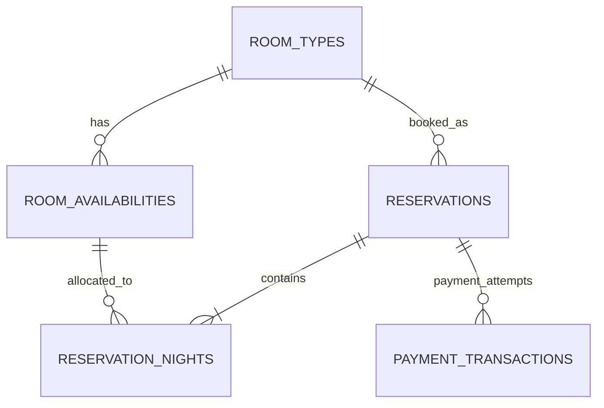

# Database hotel

Semua nilai uang disimpan sebagai integer rupiah, dengan mata uang `IDR`.
Model ini menjual stok berdasarkan **tipe kamar**, bukan nomor kamar fisik.
Penempatan nomor kamar saat check-in dapat ditambahkan kemudian.



| Tabel | Isi |
| --- | --- |
| `room_types` | Slug, nama, kapasitas per kamar, pilihan kasur, harga dasar, tarif sarapan, status aktif |
| `room_availabilities` | Stok total, kamar diblokir, dan tarif opsional per tipe per tanggal |
| `reservations` | Kode booking, kontak tamu, tanggal, jumlah kamar/tamu, snapshot nama kamar dan total biaya, status, masa hold |
| `reservation_nights` | Alokasi jumlah kamar dan snapshot tarif setiap malam |
| `payment_transactions` | Riwayat percobaan pembayaran, referensi lokal UUID, provider dan ID transaksi provider, nominal, status, waktu pembayaran/kedaluwarsa/refund |

## SQLite sementara

Lingkungan lokal memakai `DB_CONNECTION=sqlite` dan file
`database/database.sqlite`. `.env` lokal berisi path absolut ke file tersebut.
Migrasi dan enam tipe kamar sudah dapat digunakan tanpa kredensial MySQL.
SQLite ditujukan untuk pengembangan sementara. Untuk menerima pemesanan bersamaan
pada produksi, gunakan MySQL/InnoDB sesuai mekanisme row lock service.

## Migrasi dan data awal MySQL

Buat database MySQL `ipb_hotel`, lalu isi konfigurasi `DB_*` pada `.env`.
Jangan commit password database.

```sh
php artisan migrate
php artisan db:seed --class=RoomTypeSeeder
```

Seeder memasukkan enam tipe dari `RESERVATION_ROOMS` frontend. Harga awal:
Standard 600.000, Superior 700.000, Deluxe 850.000, Executive 900.000,
Grand Executive 1.050.000, dan Executive Suite 1.500.000 rupiah per malam.
Data ini mengikuti form reservasi yang ada; harga kartu pemasaran sebelumnya
berbeda untuk beberapa tipe dan perlu diselaraskan saat frontend dihubungkan.
Kapasitas serta opsi kasur mengikuti deskripsi tipe di form dan perlu ditinjau
hotel sebelum dipakai menerima reservasi nyata.

Seeder boleh diulang: data yang sudah diedit tidak ditimpa. Seeder tidak membuat
akun admin, nomor kamar, stok, reservasi, atau transaksi pembayaran fiktif.

## Mengisi stok

Tanggal akhir bersifat eksklusif, sama dengan check-out. Contoh di bawah adalah
**contoh perintah**, bukan jumlah stok hotel sebenarnya. Ganti tanggal dan jumlah
sesuai alokasi yang disetujui hotel; tanggal harus hari ini atau sesudahnya.

```sh
php artisan hotel:inventory deluxe 2026-11-01 2026-12-01 --rooms=10 --blocked=1
php artisan hotel:inventory suite 2026-11-01 2026-11-08 --rooms=2 --price=1600000
```

Perintah pertama mengisi setiap malam dari 1 sampai 30 November. Stok bersih
sebelum reservasi adalah 9 kamar per malam. `--price` opsional; jika tidak diisi,
tarif malam mengikuti harga dasar tipe kamar. Menjalankan perintah lagi mengubah
stok/tarif tanggal tersebut. Penurunan stok yang melanggar reservasi aktif ditolak.
Satu operasi menerima rentang maksimal 365 malam.

Stok untuk tanggal yang belum diisi dianggap **tidak tersedia**, bukan tak terbatas.
Stok tanggal check-out tidak dikonsumsi sehingga dapat dipakai tamu berikutnya.

## Pemakaian dari backend

```php
$room = App\Models\RoomType::where('slug', 'deluxe')->firstOrFail();
$availability = app(App\Services\RoomAvailabilityService::class)
    ->forStay($room, '2026-11-02', '2026-11-04');

$reservation = app(App\Services\ReservationService::class)->hold([
    'room_type_id' => $room->id,
    'check_in' => '2026-11-02',
    'check_out' => '2026-11-04',
    'room_count' => 1,
    'guest_count' => 2,
    'guest_name' => 'Nama Tamu',
    'guest_email' => 'guest@example.com',
    'guest_phone' => '081234567890',
    'bed_type' => 'queen',
    'with_breakfast' => true,
]);
```

`guest_count` berarti total tamu dalam seluruh booking. Sarapan dihitung per tamu
per malam, tidak dikalikan lagi dengan jumlah kamar. Tarif dan total dihitung
server; nominal atau status yang disisipkan pemanggil diabaikan. Promo IPB2026 yang ditampilkan frontend dihitung server dari config/booking.php
sebesar 10% subtotal kamar. Diskon tidak dikenakan pada sarapan dan disimpan
sebagai discount_amount bersama promo_code pada reservasi.

`hold()` memvalidasi kapasitas, pilihan kasur, tanggal, stok harian, dan status tipe
kamar. Operasi ini menggunakan transaksi database dan row lock MySQL. Semua
penulisan stok harus melalui `RoomInventoryService`; booking baru harus melalui
`ReservationService`, agar pemeriksaan kapasitas dan urutan lock tetap konsisten.

## Status dan pembayaran

- Reservasi: `pending`, `confirmed`, `checked_in`, `completed`, `cancelled`, `expired`.
- Pembayaran: `pending`, `paid`, `failed`, `expired`, `cancelled`, `refunded`.
- Hold reservasi pending berlaku 30 menit. Setelah waktunya lewat, alokasi tidak
  dihitung lagi meskipun kolom status belum diubah menjadi `expired`.
- Reservasi confirmed/checked-in/completed tetap mengonsumsi alokasi tanggalnya.
  Reservasi cancelled/expired tidak mengonsumsi stok.
- Satu reservasi dapat memiliki beberapa percobaan pembayaran, sehingga kegagalan
  dan percobaan ulang tidak menghapus riwayat.
- Kombinasi provider dan ID transaksi provider harus unik. FK melindungi riwayat
  reservasi dan pembayaran dari penghapusan relasi secara tidak sengaja.

Tabel pembayaran baru menyediakan penyimpanan. Pembuatan invoice gateway,
verifikasi signature webhook, validasi nominal/currency, idempotensi event,
konfirmasi booking, penanganan pembayaran setelah hold kedaluwarsa, dan proses
refund belum diimplementasikan. Jangan mengubah booking menjadi confirmed dari
callback browser atau dari sekadar insert transaksi pembayaran.

## Koneksi form dan endpoint

Form React sudah terhubung ke endpoint web yang memakai session dan CSRF:
`GET /booking/room-types`, `POST /booking/quote`, dan `POST /reservations`.
Quote menghitung harga tanpa menahan stok. Submit memeriksa ulang seluruh malam,
menyimpan reservasi pending, snapshot tarif, promo, dan kode booking server.

Frontend mengirim UUID `request_id` untuk mencegah booking ganda pada pengiriman
ulang. `expected_total` dibandingkan dengan hitungan server; harga yang berubah
memerlukan pemeriksaan ulang oleh tamu. Total atau status dari klien tidak dipakai
sebagai sumber harga/status. Request fingerprint mencegah UUID dipakai untuk
payload tamu yang berbeda. Nomor booking belum menjadi bukti pembayaran.

Gateway, webhook, dan dashboard admin belum terhubung. Inquiry kontak tetap
memakai WhatsApp. SQLite lokal dipakai sementara; MySQL tetap target produksi.

Tes mencakup migrasi, seed berulang, snapshot harga, stok habis, hold kedaluwarsa,
kapasitas tamu, pilihan kasur, check-out eksklusif, pengubahan stok, constraint
transaksi provider, dan perlindungan riwayat. Pengujian default memakai SQLite
in-memory. Migrasi dan suite yang sama juga diverifikasi pada MySQL 9.3 sementara;
pemesanan bersamaan untuk satu stok diverifikasi dengan dua proses PHP terpisah.
